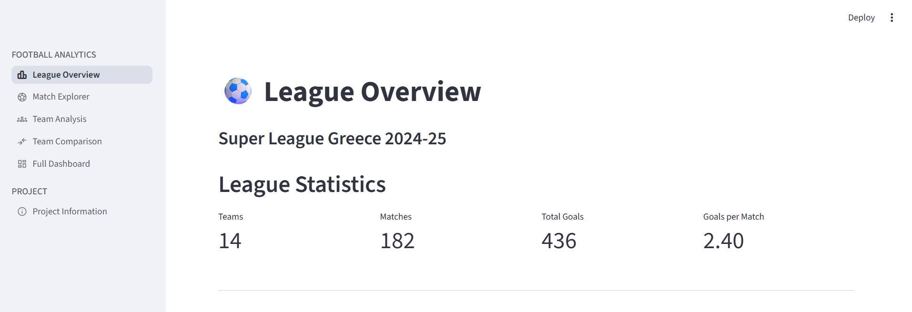
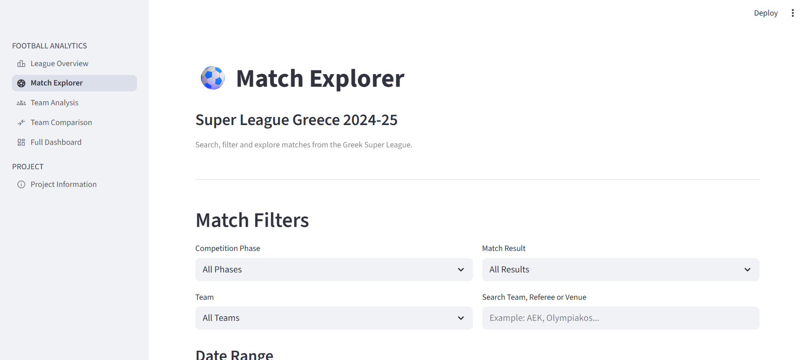
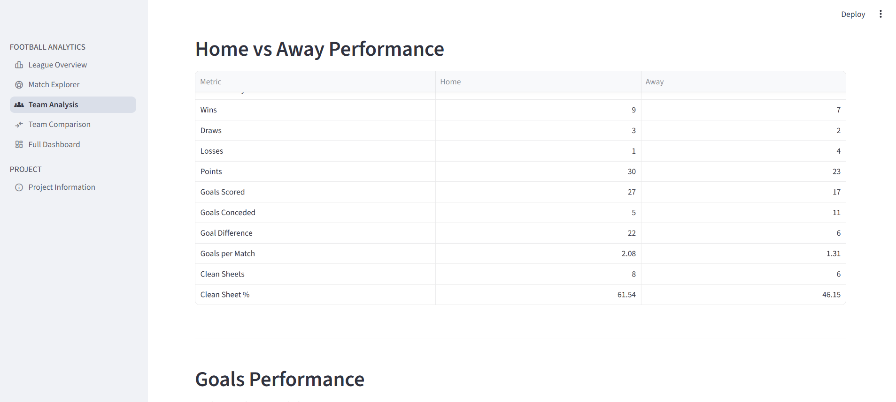
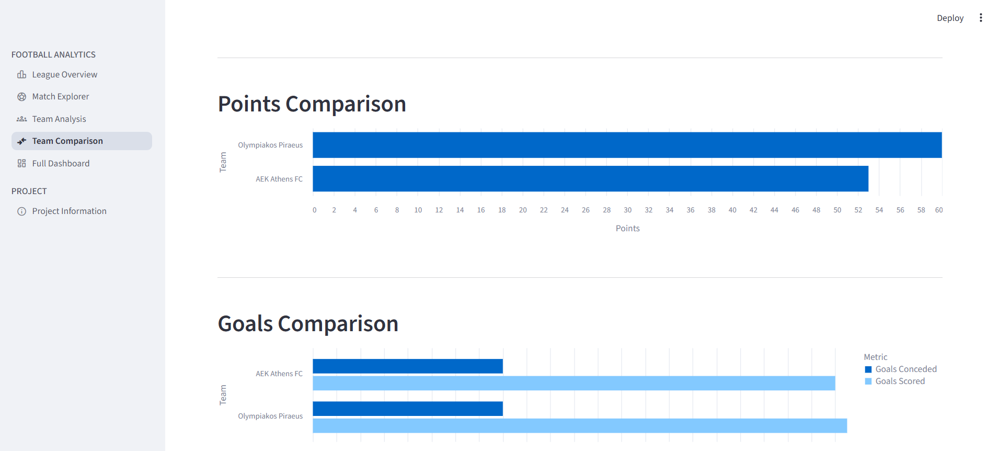

# Greek Football Analytics

A data analytics project focused on the **2024–25 Greek Super League**, built with Python and Streamlit. The project collects, processes, validates and analyses football match data to explore team performance, league standings, goals and home-versus-away trends.

## Project Overview

The aim of this project is to transform football match data into useful insights through data analysis and interactive visualisation.

The dataset contains **236 matches** from the 2024–25 Greek Super League season, including the Regular Season and the post-season phases.

The project focuses on team-level and match-level analysis, with an emphasis on data quality, reproducible calculations and clear presentation of results.

## Key Features

- **League Overview:** Key league statistics, standings and team performance indicators.
- **Match Explorer:** Search and filter matches by phase, team, result, date and other available match information.
- **Team Analysis:** Examine an individual team's results, goals scored and conceded, and home/away performance.
- **Team Comparison:** Compare two teams using performance metrics and visualisations.
- **Data Validation:** Run automated checks to identify missing, duplicate or inconsistent match data.
- **Automated Tests:** Use `pytest` to test the shared team-metrics calculations.

## Application Preview

### League Overview Dashboard






## Dataset

**Competition:** Greek Super League  
**Season:** 2024–25  
**Data source:** [API-Football](https://www.api-football.com/)  
**Total matches:** 236  
**Regular Season matches:** 182  
**Regular Season teams:** 14

The processed match dataset includes fields such as:

- Fixture ID and match date
- Home and away teams
- Goals scored by each team
- Match status
- Competition phase and round
- Referee
- Venue and city

The original raw API responses are kept outside version control. The processed dataset and selected analytical outputs are included in this repository.

## Selected Findings

The following figures refer to the **Regular Season**, unless otherwise stated.

| Metric | Result |
|---|---:|
| Matches analysed | 182 |
| Teams | 14 |
| Total goals | 436 |
| Average goals per match | 2.40 |
| Matches played by each team | 26 |

### Regular Season Highlights

- **Olympiakos** finished first in the calculated Regular Season table with 60 points.
- **AEK Athens** recorded 14 clean sheets, the highest total in the Regular Season dataset.
- **PAOK** scored 51 goals, the highest team total in the Regular Season.
- The Regular Season produced an average of 2.40 goals per match.

These findings are based on the processed dataset included in this repository.

*Note: The analytical league table is calculated using points, goal difference and goals scored. Its ordering may differ from the official ranking if additional competition-specific tie-break rules apply.*

## Technologies

- **Python** — data processing and analysis
- **Pandas** — data manipulation and aggregation
- **Streamlit** — interactive web application
- **Altair** — interactive data visualisation
- **Matplotlib** — charts and visual outputs
- **Pytest** — automated testing
- **Git & GitHub** — version control

## Project Structure

```text
greek-football-analytics/
│
├── app.py
├── build_dataset.py
├── requirements.txt
├── README.md
├── pytest.ini
├── .env.example
│
├── data/
│   └── processed/
│       ├── matches.csv
│       ├── regular_season_table.csv
│       ├── team_statistics.csv
│       ├── home_away_analysis.csv
│       ├── goals_per_match.csv
│       ├── clean_sheets_analysis.csv
│       └── ... analytical charts and reports
│
├── pages/
│   ├── dashboard.py
│   ├── league_overview.py
│   ├── match_explorer.py
│   ├── team_analysis.py
│   ├── team_comparison.py
│   └── project_info.py
│
├── utils/
│   ├── data_loader.py
│   ├── data_validation.py
│   ├── logger.py
│   └── team_metrics.py
│
└── tests/
    └── test_team_metrics.py
```

## Installation

### 1. Clone the repository

```bash
git clone https://github.com/HarrisPapadakis/greek-football-analytics.git
cd greek-football-analytics
```

### 2. Install dependencies

```bash
python -m pip install -r requirements.txt
```

### 3. Run the Streamlit application

```bash
python -m streamlit run app.py
```

The application will open in your browser.

### API Configuration

The processed dataset required by the dashboard is included in this repository, so an API key is **not required** to run the existing application.

To collect new data from API-Football, create a `.env` file in the project root and add your API key:

```text
API_FOOTBALL_KEY=your_api_key_here
```

Keep your personal `.env` file private. It is excluded from version control.

## Data Quality and Testing

Data quality is an important part of this project.

Run the validation module:

```bash
python -m utils.data_validation
```

The validation process checks items including:

- Required dataset columns
- Duplicate fixture IDs
- Missing match scores
- Negative goal values
- Match completion status
- Regular Season match coverage
- Team match counts
- Goals and points consistency

**Latest validation result: 12 checks passed, 0 failed.**

Run the automated tests:

```bash
python -m pytest -v
```

**Latest test result: 6 tests passed.**

## Scope and Limitations

This project currently focuses on match-level and team-level statistics available in the collected API data.

It does not currently provide full event-level tactical analysis, player tracking or expected goals (xG) modelling. These would require additional data sources or more detailed match data.

The project is intended as an evolving football analytics portfolio, with further analysis and visualisation features to be added.

## Author

**Harris Papadakis**

GitHub: [HarrisPapadakis](https://github.com/HarrisPapadakis)

Project repository: [Greek Football Analytics](https://github.com/HarrisPapadakis/greek-football-analytics)
